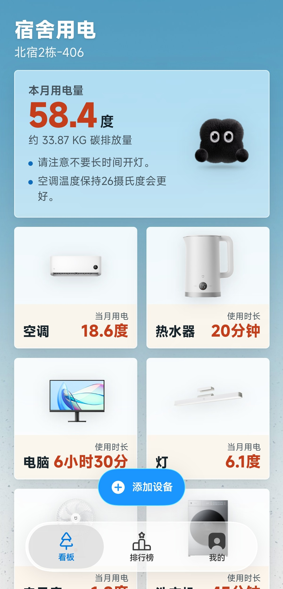

# 碳看版 · CarbonHelper v0.1.8 📊🌱

> 面向大学生宿舍场景的 AI 低碳生活管家。实时追踪宿舍用电碳足迹、低碳任务打卡、校园排行榜、碳商城兑换，还有一只陪你减碳的伙伴 **碳小绒**。



## 🏆 项目背景

本项目为 **"重庆市第三届大学生 AI 创新应用大赛"** **AI+绿色低碳方向**参赛作品。围绕"双碳"目标下绿色低碳产业发展需求，聚焦校园场景下的**碳足迹追踪、绿色能源管理**等核心场景，旨在打造一款轻量化、高趣味的低碳生活实训工具，帮助青年学生建立低碳意识、养成减碳习惯。

## ✨ 核心功能

| 模块 | 说明 |
|------|------|
| 💡 **宿舍用电看板** | 月度用电总览、AI 智慧用电建议、电器级（空调/热水器/电脑/灯/净水器等）用电指标实时轮播 |
| 🎯 **绿色打卡** | 10 项低碳行为任务（骑行上学、随手关灯、光盘行动、自带水杯等），完成即获碳积分 |
| 🏅 **低碳排行榜** | 本班 / 本校 / 本市三档排行榜，前三名领奖台 + 我的排名独立高亮行 |
| 🛒 **碳商城** | 碳积分兑换实物好礼，库存/兑换记录管理 |
| 🐾 **碳小绒** | 你的低碳宠物，积分越多宠物越萌：种子碳宝 → 发芽碳宝 → 碳小绒，每天点击互动 +1 积分 |
| 🧠 **AI 智慧诊断** | 用电异常检测、节能建议、本周碳周报 |
| 📝 **绿色低碳知识竞赛** | 随机 15 题答题，答对 +10 碳积分 |

## 🛠 技术栈

- **Android** — Kotlin（`MainActivity` WebView 容器 + 原生桥接 `TankanBridge`）
- **前端** — HTML + CSS + 原生 JavaScript（无框架，单文件 `app.js`）
- **构建** — Gradle / Android Gradle Plugin
- **存储** — `localStorage`（前缀 `tankan:`），原生注入系统字号缩放与键盘避让
- **字体** — Mi Sans

## 📁 项目结构

```
CarbonHelper/
├── Tankan/                          # Android 主工程
│   ├── app/src/main/
│   │   ├── assets/                  # 前端资源（index.html / css / js / img / fonts）
│   │   ├── java/com/carbonhelper/   # Kotlin 源码（MainActivity / 原生桥接）
│   │   └── res/                     # Android 资源
│   └── keystore/                    # 签名密钥（已 .gitignore）
├── Resource/                        # 设计源文件（字体、图标、图片）
├── cuter/                           # 碳宠物原始设计稿（docx，已迁入 CSS）
├── 低碳校园/                        # 早期 HTML 原型（历史参考）
├── 展示/                            # 演示截图与视频
│   └── 效果演示图/
├── dist/                            # 编译产物（APK，已 .gitignore）
└── README.md / LICENSE
```

## 🔨 构建

```bash
# 前置条件：Android Studio（JDK bundled）+ Android SDK（minSdk 31）
# Windows PowerShell
$env:JAVA_HOME = "D:\Android Studio\jbr"
cd Tankan
.\gradlew assembleRelease

# 产物位置
# app/build/outputs/apk/release/app-release.apk
```

首次构建需要 `local.properties` 指定 SDK 路径，可由 Android Studio 自动生成。

## 📄 开源许可

本项目基于 **MIT License** 开源，详见 `LICENSE` 文件。

项目部分 UI 设计参考了开源项目 [AndroidLiquidGlass](https://github.com/Kyant0/AndroidLiquidGlass)（Apache License 2.0），特此致谢。
