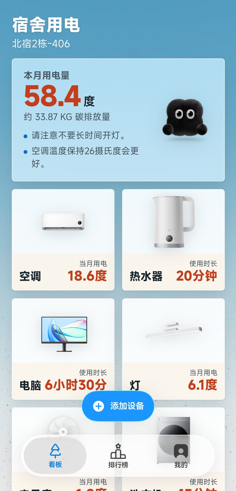

# 碳看版 · CarbonHelper 2

> 面向大学生宿舍场景的 AI 低碳生活管家。实时追踪宿舍用电碳足迹、低碳任务打卡、校园排行榜、碳商城兑换，还有一只陪你减碳的伙伴 **碳小绒**。



##  项目背景

本项目为 **"重庆市第三届大学生 AI 创新应用大赛"** **AI+绿色低碳方向**参赛作品。围绕"双碳"目标下绿色低碳产业发展需求，聚焦校园场景下的**碳足迹追踪、绿色能源管理**等核心场景，旨在打造一款轻量化、高趣味的低碳生活实训工具，帮助青年学生建立低碳意识、养成减碳习惯。

##  核心功能

| 模块 | 说明 |
|------|------|
|  **宿舍用电看板** | 月度用电总览、AI 智慧用电建议、电器级用电指标实时轮播 |
|  **智能建议** | 宿舍级 / 电器级 AI 对话上下文、演示对话与本地兜底建议，可接入 DeepSeek |
|  **绿色打卡** | 10 项低碳行为任务（骑行上学、随手关灯、光盘行动、自带水杯等），完成即获碳积分 |
|  **低碳排行榜** | 本班 / 本校 / 本市三档排行榜，前三名领奖台 + 我的排名独立高亮行 |
|  **碳商城** | 碳积分兑换实物好礼，库存/兑换记录管理 |
|  **碳小绒** | 统一 AI 形象，随积分成长：种子碳宝 → 发芽碳宝 → 碳小绒，每天点击互动 +1 积分 |
|  **绿色低碳知识竞赛** | 随机 15 题答题，答对 +10 碳积分 |

##  技术栈

- **Android** — Kotlin（`MainActivity` WebView 容器 + 原生桥接 `TankanBridge`），`minSdk 31`（Android 12）
- **UI** — Compose 液态玻璃控件（`AndroidLiquidGlass`）+ 原生 HTML/CSS/JS 单页
- **显示** — 锁定浅色模式、纯黑窗口底、`WindowInsetsController` 沉浸式隐藏状态栏、Android 12 SplashScreen
- **构建** — Gradle 9.7.1 / Android Gradle Plugin，JDK 17
- **存储** — `localStorage`（前缀 `tankan:`），原生注入系统字号缩放与键盘避让
- **字体** — Mi Sans

##  项目结构

```
CarbonHelper/
├── Tankan/                          # Android 主工程
│   ├── app/src/main/
│   │   ├── assets/                  # 前端资源（index.html / css / js / img / fonts）
│   │   ├── java/com/carbonhelper/   # Kotlin 源码（MainActivity / 原生桥接 / 液态玻璃控件）
│   │   └── res/                     # Android 资源
│   └── keystore/                    # 签名密钥（不入库，需自备）
├── Resource/                        # 设计源文件
│   ├── pictures/Electrical things/  # 电器图标素材
│   └── pictures/AI形象.png          # 碳小绒形象（透明底）
├── AndroidLiquidGlass-2.0.1/        # 上游开源参考工程
├── 文案.md                          # 全站预设文案总表（含可填写的修改列）
├── README.md / LICENSE / .gitignore
├── cuter/                           # 碳宠物原始设计稿（历史）
├── 低碳校园/                        # 早期 HTML 原型（历史参考）
├── 展示/                            # 演示截图与视频
└── dist/                            # 本地编译产物（APK 不入库，由 Release 分发）
```

##  构建

```powershell
# 前置条件：Android Studio（JDK bundled）+ Android SDK（minSdk 31）
$env:JAVA_HOME = "D:\Android Studio\jbr"
cd Tankan
.\gradlew assembleDebug      # 调试包
.\gradlew assembleRelease    # 发布包（需自备签名配置）

# 产物位置
# app/build/outputs/apk/debug/app-debug.apk
# app/build/outputs/apk/release/app-release.apk
```

首次构建需要 `local.properties` 指定 SDK 路径，可由 Android Studio 自动生成（该文件不入库）。

**签名说明**：`Tankan/app/build.gradle` 中的 release 签名指向 `../keystore/tankan.jks`。密钥文件与本机签名配置不随仓库分发，请自备同名 keystore 或改成你自己的 `signingConfig`；仅构建 debug 包无需密钥。

**网络说明**：`gradle/wrapper/gradle-wrapper.properties` 使用腾讯云 Gradle 镜像；依赖仓库为 `google()` / `mavenCentral()`，网络受限时可改用国内镜像。


## 📄 开源许可

本项目基于 **MIT License** 开源，详见 `LICENSE` 文件。

项目部分 UI 设计参考了开源项目 [AndroidLiquidGlass](https://github.com/Kyant0/AndroidLiquidGlass)（Apache License 2.0），特此致谢。
项目部分素材来自OPPO、小米，仅供个人学习使用，不构成商业用途，特此感谢。
此项目由AI辅助完成，可能存在缺陷，感谢您的理解。
